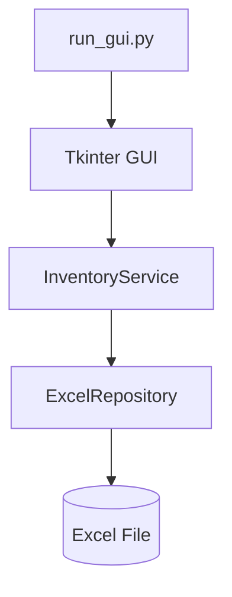
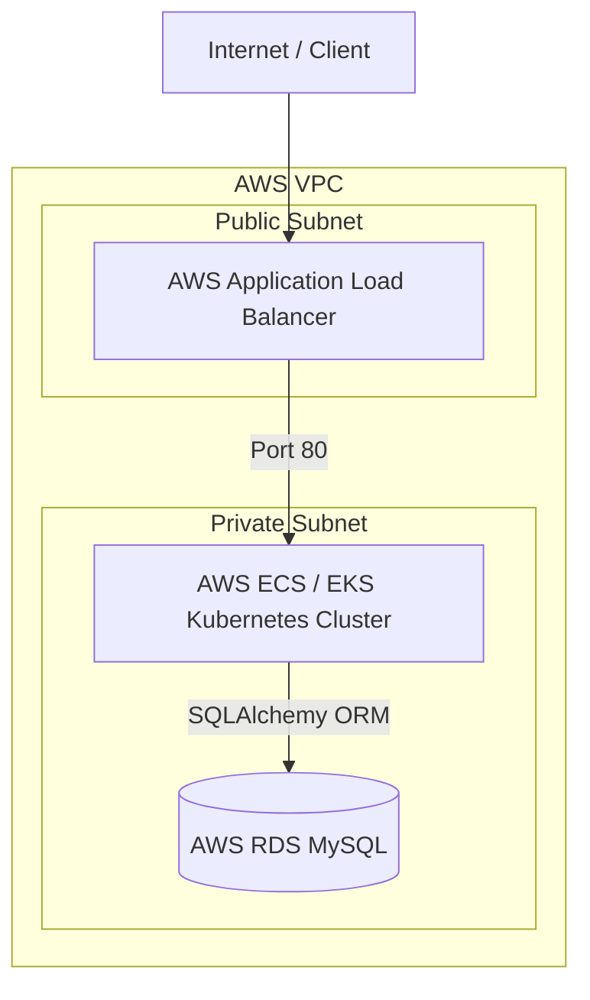

# Inventory Management System (AWS, Terraform & Kubernetes)


## 📦 Inventory Management System

An end-to-end, lightweight inventory management platform designed for daily stock **IN / OUT** tracking.

### 💡 Project Evolution
* **v1.0 (Desktop MVP):** Originally built as an internal tool for a small business, utilizing a **Tkinter GUI** with **Excel-based storage** for quick operational deployment.
* **v2.0 (Production Backend):** Refactored into a scalable enterprise solution powered by **FastAPI**, **MySQL**, **SQLAlchemy ORM**, **Docker Compose**, automated testing, **GitHub Actions CI**, and **Docker Hub** integration.
* **v3.0 (Cloud-Native Infrastructure):** Extended with **AWS Cloud Infrastructure** (ECS Fargate, RDS, ALB, ACM, KMS) automated via **Terraform (IaC)** for production-grade cloud deployment.
* **v4.0 (Next-Gen Container Orchestration):** Migrated and expanded infrastructure to **AWS EKS (Elastic Kubernetes Service)** and **Kubernetes Orchestration**, implementing Helm charts, Terraform-managed K8s manifests, and Horizontal Pod Autoscaling (HPA) for enterprise-grade workloads.

---

## ✨ Key Features

### 📦 Core Business & Application
* **Stock Management:** Streamlined inventory IN / OUT operation workflows.
* **Dual Interface:** Supports legacy Tkinter Desktop GUI alongside modern FastAPI RESTful endpoints.
* **Dual Data Layer:** Hybrid support for Excel-based file storage (baseline) and enterprise MySQL database.

### 🏗 Architecture & Code Quality
* **Clean Architecture:** Strict separation between Service Layer and Repository Layer.
* **Dependency Injection:** Modularized backend design with FastAPI's dependency injection system.
* **Domain Validation:** Robust business-rule validations and centralized error handling.

### 🧪 Quality Assurance & Testing
* **Automated Testing:** Comprehensive unit and integration testing suite powered by `pytest`.
* **Coverage Enforcement:** Enforced strict code coverage thresholds integrated directly into the CI pipeline.
* **Sample Data:** Pre-configured safe sample datasets for instant onboarding and testing.

### 🤖 DevOps & AI-Powered CI/CD
* **Containerization:** One-command local environment setup via Docker Compose.
* **Automated Pipeline:** GitHub Actions for continuous integration, automated testing, and Docker Hub registry publishing.
* **AI CI Diagnosis:** Integrated OpenAI API (`gpt-4o-mini`) to automatically diagnose CI pipeline test failures.
* **AI Code Review:** Automated PR code reviews and quality checks powered by CodeRabbit AI.

### ☁️ AWS Cloud & Kubernetes Orchestration (IaC & EKS)
* **Kubernetes Migration & Management:** Deployment architecture leveraging AWS EKS, custom Helm charts, and Terraform-managed Kubernetes manifests.
* **Autoscaling & Resilience:** Configured Horizontal Pod Autoscaler (HPA) for dynamic container workloads and dynamic traffic demands.
* **S3 + DynamoDB Remote Backend:** Secure state management with automated DynamoDB state-locking for IaC collaboration.
* **AWS ECS & ECR Containerization:** Automated build pipelines targeting Amazon ECR with serverless deployment capabilities on AWS ECS Fargate.
* **AWS Secrets Manager & KMS:** Dynamic runtime injection of RDS database credentials and API secrets with KMS key management.
* **Domain, Route 53 & SSL (ACM):** Provisioned custom domain routing via Route 53 with automated SSL/TLS certificate issuing through AWS ACM.

---

## 🏗 Architecture

The project contains two decoupled execution paths sharing core business logic patterns.

### 1. Excel-Based GUI Baseline



### 2. Cloud-Native Backend Architecture (FastAPI + Cloud Infrastructure)

The Excel-based GUI is retained as the stable original implementation. The FastAPI + MySQL path demonstrates how the business logic evolves into a containerized, cloud-native RESTful API deployed on AWS infrastructure (ECS / EKS) via Terraform.

#### ☁️ AWS Cloud Infrastructure



```text
HTTP Client / Swagger UI
    ↓
FastAPI Endpoints
    ↓
InventoryMySQLService (Business Logic & Validation)
    ↓
MySQLRepository (Persistence Abstraction)
    ↓
SQLAlchemy ORM
    ↓
AWS RDS MySQL Database
```

---

## 📁 Project Structure

Key project files and directories:

```text
inventory-db-aws-gcp-tf-k8/
├── .github/
│   └── workflows/
│       └── deploy-aws.yml     # GitHub Actions CI/CD pipeline configuration
├── api/
│   └── fastapi_app.py         # FastAPI instance setup and route definitions
├── app/
│   ├── db.py                  # Database connection & SQLAlchemy Session setup
│   ├── mysql_models.py        # SQLAlchemy ORM Data Models
│   └── check_*.py             # Health check & diagnostic scripts
├── config/
│   └── constants.py           # Application constants & configuration settings
├── core/
│   ├── exceptions.py          # Custom domain exceptions
│   ├── inventory_service.py   # Business logic for Excel baseline
│   ├── inventory_mysql_service.py # Business logic for MySQL engine
│   └── item.py                # Core Domain models
├── data/
│   └── sample_inventory.xlsx  # Safe sample dataset for local testing
├── repository/
│   ├── excel_repository.py    # Data access layer for Excel persistence
│   └── mysql_repository.py    # Data access layer for MySQL via SQLAlchemy
├── terf/                      # Infrastructure as Code (Terraform & K8s)
│   ├── environment/           # Cloud environments setup
│   │   ├── aws/               # AWS ECS/EKS Infrastructure modules
│   │   └── gcp/               # GCP Infrastructure modules
│   ├── modules/               # Reusable Terraform modules
│   ├── backend.tf             # S3 backend & DynamoDB state locking
│   ├── dns_acm.tf             # Route53 DNS & ACM SSL Certificate management
│   ├── ecr.tf                 # AWS ECR container repository setup
│   ├── ecs.tf                 # AWS ECS Fargate cluster, service, & task definitions
│   └── main.tf / variables.tf # Primary terraform provider & input configuration
├── tests/                     # Unit and integration test suite (pytest)
├── ui/
│   └── gui_app.py             # Tkinter Desktop GUI interface
├── Dockerfile.aws             # Container image build instructions (for AWS)
├── Dockerfile.gcp             # Container image build instructions (for GCP)
├── docker-compose.yml         # Local multi-container development environment
├── run_api.py                 # Entry point for FastAPI backend
└── run_gui.py                 # Entry point for Desktop GUI
```

Generated cache files, local environment files, database data, test artifacts, and private Excel files are intentionally omitted from this structure.

---

## ⚙️ Requirements & Prerequisites

### Local Development Environment
* **Python:** `3.11+`
* **Package Manager:** `pip`
* **Database (Optional for API path):** `MySQL 8.0+`

### Container & Cloud Tools
* **Docker Engine:** `20.10+`
* **Docker Compose:** `v3.0+`
* **Terraform:** `v1.5+`
* **Kubernetes CLI (Optional):** `kubectl` & `helm` (for K8s management)

---

## 🚀 Quick Start & Installation

### 1. Clone Repository & Setup Virtual Environment

```bash
git clone https://github.com/alextwtp/inventory-db-aws-gcp-tf-k8.git
cd inventory-db-aws-gcp-tf-k8

# Create and activate virtual environment
python3 -m venv venv
source venv/bin/activate  # On Windows: venv\Scripts\activate
```

---

### 2. Install Dependencies

```bash
pip install --upgrade pip
pip install -r requirements.txt
```

### 3. Environment Configuration
Create a local `.env` file based on `.env.example`:

```bash
cp .env.example .env
```

Example host configuration (if access via alextwtp.online):

```env
DB_HOST=<your database url>
DB_PORT=3306
DB_NAME=<your database name>
DB_USER=<your ID>
DB_PASSWORD=<your password>
```

> 🔒 **Security Warning:** The actual `.env` file contains sensitive credentials and is strictly excluded via `.gitignore`. Never commit `.env` files to version control.

### MySQL Port Mapping (if run through run_api.py)

When connecting from the host machine or WSL:

```env
DB_HOST=127.0.0.1
DB_PORT=3307
```

When the application connects to MySQL inside Docker Compose:

```env
DB_HOST=mysql
DB_PORT=3306
```

Example MySQL Workbench connection:

```text
Host: 127.0.0.1
Port: 3307
User: root
Database: inventory_db
```

---

## 🖥️ Run the Excel-Based GUI

The GUI version is the original baseline implementation and operates directly with the Excel repository.

### Launch Instructions
Run the GUI from the project root:

```bash
# macOS / Linux
python3 run_gui.py

# Windows
python run_gui.py
```

> 💡 **Architecture Note:** The GUI entry script automatically instantiates the Tkinter interface and injects both `ExcelRepository` and `InventoryService`. The FastAPI server and MySQL database are not required when running this standalone desktop path.

---

## 🐳 Run FastAPI + MySQL via Docker & Local Python

### 1. Start MySQL Container
Launch the database container using Docker Compose:

```bash
docker compose up -d
```

Useful Container Commands:
```bash
# Check service status
docker compose ps

# View real-time service logs
docker compose logs -f

# Stop running services
docker compose down

# Stop services and wipe persistent database volume
docker compose down -v
```

> ⚠️ **Warning:** `docker compose down -v` permanently deletes the database volume and stored inventory data.

---

### 2. Start FastAPI Server
Launch the API server from the project root:

```bash
python run_api.py
```

* **Default API Endpoint:** `http://127.0.0.1:8000`
* **Interactive Swagger Documentation:** `http://127.0.0.1:8000/docs`

---

## 🔌 FastAPI + MySQL API Endpoints

Examples below assume local execution at `http://127.0.0.1:8000`.

### 1. Health Check
`GET /`

```bash
curl http://127.0.0.1:8000/
```

* **Response Example:**
```json
{
  "status": "ok",
  "message": "Inventory MySQL API is running"
}
```

### 2. Get Item Details
`GET /item/{pid}`

```bash
curl http://127.0.0.1:8000/item/A001
```

* **Response Example (`200 OK`):**
```json
{
  "status": "success",
  "message": "Item found",
  "item": {
    "pid": "A001",
    "name": "MOUSE",
    "current_qty": 10,
    "buyer": "",
    "shipper": ""
  }
}
```

### 3. Inventory IN (Stock Inbound)
`POST /inventory/in`

```bash
curl -X POST http://127.0.0.1:8000/inventory/in \
  -H "Content-Type: application/json" \
  -d '{
    "pid": "A001",
    "name": "MOUSE",
    "qty": 5,
    "receiver": "",
    "shipper": "Vendor A"
  }'
```

### 4. Inventory OUT (Stock Outbound)
`POST /inventory/out`

```bash
curl -X POST http://127.0.0.1:8000/inventory/out \
  -H "Content-Type: application/json" \
  -d '{
    "pid": "A001",
    "name": "MOUSE",
    "qty": 2,
    "receiver": "Customer A",
    "shipper": ""
  }'
```

> 🛡️ **Error Handling Strategy:**
> * Application-level validation errors are automatically caught and formatted into standard HTTP status codes (`400 Bad Request`, `404 Not Found`).
> * Unexpected SQLAlchemy or transaction failures trigger an immediate database session rollback and return an `HTTP 500 Internal Server Error`.

---

## 🧪 Testing & Automated Verification

The project includes unit and integration tests written with `pytest`, covering both repository implementations and API endpoints.

### Executing Test Suite

Run the full test suite in quiet mode:

```bash
pytest -q
```

Run tests with line-by-line coverage analysis:

```bash
pytest --cov=. --cov-report=term-missing
```

### Verified Test Results:

```text
59 passed 
Required test coverage of 80% reached
Total coverage: 85.12%
```

### Testing Strategy

The automated test suite covers:

* **Business Logic:** Core inventory business rules, stock IN/OUT transactions, and edge cases (invalid quantity, insufficient stock, item not found).
* **Data Access & Repositories:** Data persistence behavior for both Excel and MySQL storage layers.
* **API & Web Layer:** FastAPI routing, request/response validation, dependency injection wiring, and global error handling.
* **Transaction Safety:** Database session rollback behavior under failure conditions.

> ⚡ **Mocking & Isolation Design:** API-layer unit tests utilize mock/fake service objects where appropriate. This design choice keeps execution extremely fast and deterministic without requiring a running MySQL container for every test run.

---

## 📊 Sample Inventory Data

A safe sample Excel file is provided for testing and system demonstration:

```text
data/sample_inventory.xlsx
```

---

## ⚙️ GitHub Actions CI/CD & AI-Driven Failure Diagnosis

The project utilizes GitHub Actions (`deploy-aws.yml`) for automated testing, intelligent AI-driven failure diagnosis, code review automation, and container delivery.

### Workflow Architecture

```text
Source Push / PR
    ↓
Set up Python & Dependencies
    ↓
Run pytest & Coverage Gate (80%)
    ├─► [SUCCESS] ──► Build Docker Image ──► Push to Docker Hub / Registry
    │
    └─► [FAILURE] ──► Trigger AI Failure Diagnosis (OpenAI API)
                            ↓
                      Parse pytest.log
                            ↓
                      Generate Actionable Fix Suggestions
```

### Pipeline Execution Phases:
1. **CI Testing & Coverage Gate:** Automated testing across Python 3.11 & 3.12.
2. **AI Failure Diagnosis (`gpt-4o-mini`):** Parses test failure logs and outputs automated root-cause analysis when tests fail.
3. **AI PR Review:** Automated PR code reviews powered by CodeRabbit AI.
4. **Registry Push:** Automated image build and distribution to Docker Hub. *(AWS ECS/ECR deployment phase can be toggled via workflow configuration for cloud cost management).*

---

## 🐳 Docker Container Registry & Images

The application image is packaged and published to Docker Hub for public verification and containerized deployments.

### Public Image Artifacts
* **Repository:** `alextwtpyeh/inventory-db-aws-terraform-k8s`
* **Versioned Tag:** `alextwtpyeh/inventory-db-aws-terraform-k8s:v4.0.0`
* **Latest Tag:** `alextwtpyeh/inventory-db-aws-terraform-k8s:latest`

### Pull & Run Verification:

```bash
docker pull alextwtpyeh/inventory-db-aws-terraform-k8s:latest
docker run --rm alextwtpyeh/inventory-db-aws-terraform-k8s:latest pytest -q
```

---

## 🛡️ Security and Data-Safety Controls

The project adheres to strict **DevSecOps** principles, zero-trust configuration management, and least-privilege deployment safety controls:

* **Credential Isolation:** Production runtime credentials reside strictly in `.env` (excluded via `.gitignore`).
* **CI/CD Secret Store:** Sensitive variables (`DOCKERHUB_TOKEN`, `OPENAI_API_KEY`) are encrypted within GitHub Repository Secrets.
* **Sanitized Data Fixtures:** Only synthetic, non-sensitive sample datasets are committed to source control.

---

## 📜 License

This project is currently provided without an explicit open-source license. All rights reserved.